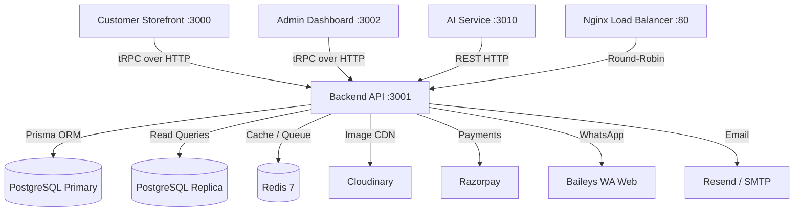
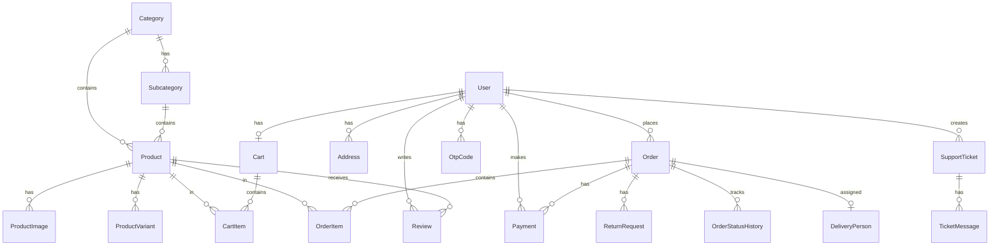

# 📖 Anmol Vastralay — Complete Project Documentation

> **Project Type:** Full-Stack E-Commerce Platform (Monorepo)
> **Business:** Premium Ethnic & Western Fashion Store — Gopalganj, Bihar, India
> **Date:** October 2026
> **Status:** Production-Ready, Deployment-Ready

---

## 📋 Table of Contents

1. [Executive Summary](#1-executive-summary)
2. [System Architecture Overview](#2-system-architecture-overview)
3. [Monorepo Folder Structure](#3-monorepo-folder-structure)
4. [Tech Stack — Tool-by-Tool Breakdown](#4-tech-stack--tool-by-tool-breakdown)
5. [Backend API (anmol-backend)](#5-backend-api-anmol-backend)
6. [Customer Storefront (anmol-frontend)](#6-customer-storefront-anmol-frontend)
7. [Admin Dashboard (anmol-admin)](#7-admin-dashboard-anmol-admin)
8. [AI Service (AI-service)](#8-ai-service-ai-service)
9. [Database Schema & Data Model](#9-database-schema--data-model)
10. [Feature-by-Feature Deep Dive](#10-feature-by-feature-deep-dive)
11. [Order Lifecycle Workflow](#11-order-lifecycle-workflow)
12. [AI & CRM Automation Workflows](#12-ai--crm-automation-workflows)
13. [Infrastructure & DevOps](#13-infrastructure--devops)
14. [Security Architecture](#14-security-architecture)
15. [SEO Strategy](#15-seo-strategy)
16. [Deployment Guide](#16-deployment-guide)

---

## 1. Executive Summary

**Anmol Vastralay** is a production-grade, enterprise-level, full-stack e-commerce platform built for a premium Indian ethnic clothing store located in Gopalganj, Bihar. The platform goes far beyond a basic online shop — it is a complete digital business ecosystem that integrates:

- 🛍️ A luxury customer-facing storefront with server-side rendering for SEO
- 🛠️ A comprehensive admin dashboard with analytics, inventory, and CRM
- 🤖 AI-powered customer support chatbot with RAG (Retrieval-Augmented Generation)
- 📲 WhatsApp Business automation for order confirmations, abandoned cart recovery, and customer retargeting
- 💳 Razorpay payment gateway integration with HMAC signature verification
- 📊 Prometheus observability stack for production monitoring
- 🏪 Point-of-Sale (POS) system for in-store transactions

The entire stack is type-safe end-to-end using tRPC, meaning the frontend, admin panel, and backend share a single source of truth for all API contracts — no manual TypeScript interfaces needed.

---

## 2. System Architecture Overview


The platform follows a **microservices-inspired monorepo architecture** with four independent deployable services:

| Service | Framework | Port | Role |
|---|---|---|---|
| **Customer Storefront** | Next.js 16 (React 19) | `3000` | Public shopping experience |
| **Backend API** | NestJS 11 | `3001` | Central business logic, tRPC server |
| **Admin Dashboard** | Next.js 16 (React 19) | `3002` | Store management, analytics, CRM |
| **AI Service** | Node.js (Vercel AI SDK) | `3010` | RAG chatbot with Gemini 3.8 Flash |

### Communication Pattern



> [!IMPORTANT]
> All read queries (product browsing, category listing) are automatically routed to the read replica pool via Prisma's `readReplicas` extension, ensuring write-heavy transactions never starve read performance.

---

## 3. Monorepo Folder Structure

```
anmol_vastralay/
├── anmol-backend/          # NestJS Backend API Server
│   ├── prisma/             # Database schema, migrations, seeds
│   │   ├── schema.prisma   # 492-line Prisma schema (20+ models)
│   │   ├── migrations/     # Version-controlled DB migrations
│   │   ├── seed.ts         # Admin user seeder
│   │   └── seed-products.ts# Product catalog seeder
│   ├── src/
│   │   ├── main.ts         # Application bootstrap & middleware stack
│   │   ├── cluster.ts      # Node.js cluster mode (vertical scaling)
│   │   ├── config/         # Redis, tRPC, ImageKit configuration
│   │   ├── controllers/    # Webhook & WhatsApp HTTP controllers
│   │   ├── cron/           # Scheduled jobs (abandoned cart scanner)
│   │   ├── models/         # Zod validation schemas (input DTOs)
│   │   ├── modules/        # NestJS dependency injection modules
│   │   ├── processors/     # BullMQ background job processors
│   │   ├── routers/        # tRPC router definitions (16 routers)
│   │   ├── services/       # Business logic layer (29+ services)
│   │   └── utils/          # Shared utility functions
│   ├── nginx/              # Nginx load balancer configuration
│   ├── Dockerfile          # Production container image
│   └── docker-compose.yml  # Local orchestration
│
├── anmol-frontend/         # Customer Storefront (Next.js)
│   ├── app/                # Next.js App Router (20+ routes)
│   │   ├── page.tsx        # Homepage with 8 UI sections
│   │   ├── collections/    # Product listing with infinite scroll
│   │   ├── product/        # Product detail page (PDP)
│   │   ├── cart/           # Shopping cart
│   │   ├── checkout/       # Checkout with Razorpay
│   │   ├── orders/         # Order history & tracking
│   │   ├── profile/        # Customer account management
│   │   ├── chatbot/        # AI chatbot page
│   │   ├── search/         # Full-text product search
│   │   ├── login/          # Authentication (Email + Google)
│   │   ├── register/       # User registration with OTP
│   │   ├── wishlist/       # Saved products
│   │   ├── about/          # About the brand
│   │   ├── contact/        # Contact form
│   │   ├── faq/            # Frequently Asked Questions
│   │   ├── guides/         # Shopping guides
│   │   ├── privacy/        # Privacy policy
│   │   ├── terms/          # Terms & conditions
│   │   ├── shipping/       # Shipping & returns policy
│   │   ├── locations/      # Store locations
│   │   ├── sitemap.ts      # Dynamic SEO sitemap
│   │   └── robots.ts       # Robots.txt configuration
│   ├── components/         # 15+ reusable UI components
│   │   ├── Navbar.tsx      # Main navigation (18KB)
│   │   ├── Footer.tsx      # Site footer (10KB)
│   │   ├── HeroSlider.tsx  # Full-screen hero carousel
│   │   ├── ProductCard.tsx # Product display card
│   │   └── ...             # Category, testimonials, etc.
│   └── lib/                # tRPC client, auth, SEO utilities
│
├── anmol-admin/            # Admin Dashboard (Next.js)
│   ├── app/
│   │   ├── login/          # Admin login with 2FA OTP
│   │   └── (admin)/        # Protected admin routes
│   │       ├── dashboard/      # Analytics overview
│   │       ├── products/       # Product CRUD management
│   │       ├── categories/     # Category management
│   │       ├── orders/         # Order management & fulfillment
│   │       ├── customers/      # CRM & customer segmentation
│   │       ├── payments/       # Payment tracking
│   │       ├── banners/        # Homepage banner management
│   │       ├── delivery-persons/ # Delivery staff management
│   │       ├── pos/            # Point-of-Sale system
│   │       ├── forecast/       # AI demand forecasting
│   │       ├── support/        # AI escalation helpdesk
│   │       ├── settings/       # WhatsApp QR connection
│   │       ├── staff/          # Staff management
│   │       └── updates/        # Real-time activity feed
│   ├── hooks/              # Custom React hooks
│   ├── lib/                # tRPC client & utilities
│   └── components/         # Admin UI components
│
├── AI-service/             # Standalone RAG AI Chatbot Service
│   ├── src/
│   │   ├── server.ts       # HTTP server (Node.js native)
│   │   ├── assistant.ts    # Gemini AI with tool-use (RAG)
│   │   ├── backend-api.ts  # Backend API proxy calls
│   │   └── config.ts       # Environment config
│   ├── knowledgeBase.json  # Store policies knowledge base
│   └── Dockerfile          # Container image
│
├── docker-compose.yml      # Full-stack orchestration (7 services)
├── graphify-out/           # Generated dependency graph
└── README.md               # Project documentation
```

---

## 4. Tech Stack — Tool-by-Tool Breakdown

### Why Each Tool Was Chosen

| Technology | Category | Why It Was Chosen |
|---|---|---|
| **Next.js 16** | Frontend Framework | Server-side rendering (SSR) for SEO, React Server Components for performance, App Router for modern routing, built-in image optimization |
| **React 19** | UI Library | Latest concurrent features, Server Components support, seamless hydration |
| **NestJS 11** | Backend Framework | Enterprise-grade dependency injection, modular architecture, decorators for clean code, built-in scheduling and queue support |
| **tRPC 11** | API Layer | **End-to-end type safety** — frontend instantly knows the exact shape of backend responses without manual types. This eliminates an entire class of bugs. |
| **Prisma 7** | ORM | Type-safe database queries, automatic migration management, read-replica extension for scaling, `pg` adapter for connection pooling |
| **PostgreSQL 16** | Primary Database | ACID transactions for order/payment integrity, robust indexing, JSON support, battle-tested for e-commerce |
| **Redis 7** | Cache & Queue | In-memory caching for product lists (sub-millisecond reads), BullMQ job queue backbone, session/OTP storage, abandoned cart timestamps |
| **BullMQ** | Job Queue | Reliable background job processing with retries, delays, and concurrency control — used for email, WhatsApp, and marketing notifications |
| **Tailwind CSS 4** | Styling | Utility-first approach for rapid, consistent, responsive UI development across all breakpoints |
| **Zod 4** | Validation | Runtime input validation on all tRPC procedures — same schemas used for both client and server validation |
| **Cloudinary** | Media CDN | Optimized image delivery, on-the-fly transformations (resize, crop, format), PDF invoice storage |
| **Razorpay** | Payment Gateway | India's leading payment processor — supports UPI, cards, netbanking, wallets. HMAC signature verification for security |
| **Baileys (WhiskeySocket)** | WhatsApp Client | Open-source WhatsApp Web protocol client — sends messages, documents, and receives incoming messages without official API costs |
| **Google Gemini** | AI/LLM | Multi-modal AI (text + image) — powers product description generation, chatbot responses, demand forecasting, and campaign message polishing |
| **Groq** | AI Accelerator | Ultra-fast LLM inference — used as a fallback/secondary model for category descriptions and campaign message polishing |
| **Vercel AI SDK** | AI Streaming | Server-side streaming for the RAG chatbot — enables real-time token-by-token response display in the frontend |
| **PDFKit** | PDF Generation | Generates professional tax invoices as PDF documents — supports custom branding, itemized tables, and payment details |
| **Resend** | Transactional Email | Modern email API — sends welcome emails and order confirmation emails with PDF attachments |
| **Nodemailer** | Email Fallback | SMTP-based email fallback when Resend is not configured — supports Gmail, Outlook, custom SMTP servers |
| **Prom-Client** | Observability | Prometheus metrics library — exposes HTTP request rates, durations, active connections, cache hits/misses, and DB query performance |
| **Helmet** | Security | HTTP security headers middleware — prevents XSS, clickjacking, MIME sniffing, and other common attacks |
| **bcryptjs** | Password Hashing | Industry-standard password hashing with configurable salt rounds (10 rounds used) |
| **JWT** | Authentication | Stateless token-based authentication — allows horizontal scaling without sticky sessions |
| **Zustand** | Client State | Lightweight state management for cart, auth, and UI state on the frontend |
| **Recharts** | Data Visualization | Charts and graphs in the admin dashboard — used for inventory distribution, sales trends, and analytics |
| **Framer Motion** | Animations | Smooth page transitions, hover effects, and micro-animations in the admin panel |
| **Lucide React** | Icons | Clean, consistent icon set used across both frontend and admin interfaces |
| **Docker** | Containerization | Consistent development and deployment environments across all services |
| **Nginx** | Load Balancer | Reverse proxy for horizontal scaling — distributes traffic across multiple backend instances |

---

## 5. Backend API (anmol-backend)

### 5.1 Entry Point & Middleware Stack

The backend bootstraps through [main.ts](file:///c:/Users/rouna/Desktop/anmol_vastralay/anmol-backend/src/main.ts) with a carefully ordered middleware pipeline:

1. **Helmet** — Security headers (XSS, clickjacking, MIME sniffing protection)
2. **Correlation ID** — Generates UUID per request for distributed tracing
3. **Prometheus Metrics** — RED method (Rate, Errors, Duration) instrumentation
4. **Request Logger** — Logs method, path, status code, and latency with correlation IDs
5. **Rate Limiter** — 500 requests per IP per 15 minutes (anti-DDoS)
6. **CORS** — Allows storefront, admin, and Vercel preview deployments
7. **ValidationPipe** — Strips unknown fields, transforms payloads
8. **tRPC Middleware** — Creates context with authenticated user, services, and Prisma client

### 5.2 tRPC Router Architecture

The API exposes **16 tRPC routers** with strict access control:

| Router | Access Level | Procedures | Purpose |
|---|---|---|---|
| `auth` | Public | `login`, `register`, `verifyOtp`, `googleAuth` | Multi-factor authentication |
| `category` | Public + Staff | `list`, `getBySlug`, `create`, `update`, `delete` | Category CRUD |
| `product` | Public + Staff | `list`, `getBySlug`, `create`, `update`, `delete`, `aiGenerate` | Product catalog with AI |
| `cart` | Protected | `get`, `add`, `update`, `remove`, `clear` | Redis-backed shopping cart |
| `order` | Protected + Staff | `create`, `getHistory`, `getDetails`, `adminGetOrders`, `adminUpdateStatus` | Order lifecycle |
| `payment` | Protected + Staff | `getHistory`, `verifyRazorpay`, `adminGetPayments` | Payment processing |
| `user` | Staff | `list`, `getById`, `update`, `delete` | User management |
| `customer` | Protected | Profile, addresses, OTP, password, delete account | Customer self-service |
| `banner` | Public + Staff | `getBanners`, `create`, `update`, `delete`, `reorder` | Banner management |
| `review` | Protected | `create`, `getByProduct` | Product reviews |
| `deliveryPerson` | Staff | `list`, `create`, `update`, `delete`, `assignToOrder` | Delivery management |
| `dashboard` | Staff | `getUpdates`, `getStats`, `getCategoryInventory`, `generateDemandForecast` | Analytics & AI insights |
| `pos` | Staff | `createOrder` | In-store POS system |
| `ticket` | Staff | `getTickets`, `getTicketDetails`, `replyToTicket` | Support helpdesk |
| `whatsapp` | Staff | `getStatus`, `logout` | WhatsApp connection |

### 5.3 Service Layer (29+ Services)

Each service encapsulates a domain:

| Service | File | Responsibility |
|---|---|---|
| `AuthService` | [auth.service.ts](file:///c:/Users/rouna/Desktop/anmol_vastralay/anmol-backend/src/services/auth.service.ts) | Login, register, OTP verification, Google OAuth, JWT token management |
| `PrismaService` | [prisma.service.ts](file:///c:/Users/rouna/Desktop/anmol_vastralay/anmol-backend/src/services/prisma.service.ts) | Database connection with read-replica load balancing via Proxy pattern |
| `CacheService` | [cache.service.ts](file:///c:/Users/rouna/Desktop/anmol_vastralay/anmol-backend/src/services/cache.service.ts) | Redis cache with `remember()` Cache-Aside pattern, hit/miss metrics |
| `AiService` | [ai.service.ts](file:///c:/Users/rouna/Desktop/anmol_vastralay/anmol-backend/src/services/ai.service.ts) | Gemini & Groq AI for product details, category SEO, demand forecasting, chatbot, retargeting, campaign polishing |
| `ChatbotService` | [chatbot.service.ts](file:///c:/Users/rouna/Desktop/anmol_vastralay/anmol-backend/src/services/chatbot.service.ts) | WhatsApp AI chatbot with Gemini function calling (4 tools) |
| `WhatsappWebService` | [whatsapp-web.service.ts](file:///c:/Users/rouna/Desktop/anmol_vastralay/anmol-backend/src/services/whatsapp-web.service.ts) | Baileys WhatsApp Web client — QR auth, message sending, document sharing |
| `OrderService` | [order.service.ts](file:///c:/Users/rouna/Desktop/anmol_vastralay/anmol-backend/src/services/order.service.ts) | Order creation with atomic stock deduction, Razorpay integration, post-order notifications |
| `PaymentService` | [payment.service.ts](file:///c:/Users/rouna/Desktop/anmol_vastralay/anmol-backend/src/services/payment.service.ts) | Razorpay HMAC signature verification, payment status tracking |
| `InvoiceService` | [invoice.service.ts](file:///c:/Users/rouna/Desktop/anmol_vastralay/anmol-backend/src/services/invoice.service.ts) | PDF invoice generation with PDFKit, upload to Cloudinary |
| `EmailService` | [email.service.ts](file:///c:/Users/rouna/Desktop/anmol_vastralay/anmol-backend/src/services/email.service.ts) | Dual-provider email (Resend primary, SMTP fallback) with HTML templates |
| `HealthService` | [health.service.ts](file:///c:/Users/rouna/Desktop/anmol_vastralay/anmol-backend/src/services/health.service.ts) | Deep health check (Primary DB, Replica DB, Redis, Memory, CPU) |
| `MetricsService` | [metrics.service.ts](file:///c:/Users/rouna/Desktop/anmol_vastralay/anmol-backend/src/services/metrics.service.ts) | Prometheus metrics (HTTP counters, histograms, gauges, cache metrics) |
| `RetargetingService` | [retargeting.service.ts](file:///c:/Users/rouna/Desktop/anmol_vastralay/anmol-backend/src/services/retargeting.service.ts) | Churn prediction & AI-powered WhatsApp retargeting |
| `NotificationProcessor` | [notification.processor.ts](file:///c:/Users/rouna/Desktop/anmol_vastralay/anmol-backend/src/processors/notification.processor.ts) | BullMQ job handler for emails, WhatsApp, abandoned carts, marketing |
| `CloudinaryService` | [cloudinary.service.ts](file:///c:/Users/rouna/Desktop/anmol_vastralay/anmol-backend/src/services/cloudinary.service.ts) | Image upload, transformation, and PDF storage |
| `OtpService` | [otp.service.ts](file:///c:/Users/rouna/Desktop/anmol_vastralay/anmol-backend/src/services/otp.service.ts) | OTP generation, email delivery, and verification |

---

## 6. Customer Storefront (anmol-frontend)

### 6.1 Pages & Features

The storefront uses **Next.js 16 App Router** with React Server Components for maximum SEO and performance:

| Page Route | Feature | Description |
|---|---|---|
| `/` | Homepage | 8-section luxury landing page: Category bubbles, hero slider, spotlight banners, curated tabs, occasion showcase, category sections, heritage values, bride testimonials |
| `/collections` | Product Listing | Filterable product grid with **infinite scroll** — loads products dynamically as user scrolls, keeping initial page load fast |
| `/product/[slug]` | Product Detail | Full product page with image gallery, variant selection (color/size), add to cart, reviews |
| `/cart` | Shopping Cart | View cart items, update quantities, remove items, proceed to checkout |
| `/checkout` | Checkout | Address selection, payment method choice (COD or Razorpay), order placement |
| `/orders` | Order History | List of all customer orders with status tracking |
| `/orders/[id]` | Order Details | Detailed order view with status timeline, items, payment info, invoice download |
| `/search` | Product Search | Full-text search across product names, descriptions, and categories |
| `/wishlist` | Wishlist | Save products for later purchase |
| `/profile` | Account Settings | Edit name, email, phone, profile image, manage addresses, change password |
| `/login` | Login | Email/phone + password login with OTP 2FA, Google Sign-In |
| `/register` | Register | New account creation with email OTP verification |
| `/chatbot` | AI Chatbot | Full-page RAG chatbot interface powered by Gemini |
| `/about` | About Us | Brand story and heritage |
| `/contact` | Contact | Contact form with store details |
| `/faq` | FAQ | Frequently asked questions accordion |
| `/shipping` | Shipping Policy | Shipping rates, delivery times, return policy |
| `/privacy` | Privacy Policy | Data collection and usage policy |
| `/terms` | Terms & Conditions | Legal terms of service |
| `/locations` | Store Locations | Physical store address and map |

### 6.2 Homepage Component Architecture

The homepage ([page.tsx](file:///c:/Users/rouna/Desktop/anmol_vastralay/anmol-frontend/app/page.tsx)) is composed of 8 premium sections:

1. **CategoryNav** — Circular "Instagram Story" style category bubbles for quick navigation
2. **HeroSlider** — Full-screen cinema-grade luxury slider with admin-managed banners
3. **SpotlightDualBanners** — Two editorial-style spotlight cards
4. **RoyalCuratedTabs** — Interactive tabbed product showcase
5. **OccasionShowcase** — "Shop By Occasion" cards (Wedding, Festival, Party, etc.)
6. **CategorySection** — Dynamic product grids per category
7. **HeritageValues** — Brand promise section (quality, authenticity, delivery)
8. **BrideTestimonials** — Social proof with customer testimonials

### 6.3 Key Design Decisions

- **Typography:** Three Google Fonts — Inter (body), Cormorant Garamond (headlines), Plus Jakarta Sans (UI elements)
- **State Management:** Zustand for client-side cart and auth state
- **Data Fetching:** tRPC React Query for type-safe server state
- **AI Integration:** Vercel AI SDK with streaming for the chatbot
- **Analytics:** Vercel Analytics for traffic monitoring
- **Phone Prompt:** `PhonePrompt` component prompts logged-in users to add their phone number for WhatsApp notifications

---

## 7. Admin Dashboard (anmol-admin)

### 7.1 Admin Pages

The admin panel provides complete store management through **14 dedicated sections**:

| Section | Route | Features |
|---|---|---|
| **Dashboard** | `/dashboard` | Real-time stats (categories, products, low stock, customers), quick overview cards |
| **Products** | `/products` | Full CRUD with **AI-powered product description generation** (image + text → Gemini), variant management (color, size, stock), bulk image upload to Cloudinary |
| **Categories** | `/categories` | Category/subcategory management with **AI-generated SEO metadata**, drag-and-drop reordering |
| **Orders** | `/orders` | Order list with status filtering, status updates (PENDING → PROCESSING → SHIPPED → DELIVERED), order timeline history |
| **Customers** | `/customers` | Customer CRM with **LTV segmentation** (VIP, Regular, Dormant, New), bulk WhatsApp broadcasting, contact management |
| **Payments** | `/payments` | Payment history tracking, status monitoring |
| **Banners** | `/banners` | Homepage hero banner management with image upload, drag-and-drop reordering via `@dnd-kit` |
| **Delivery Persons** | `/delivery-persons` | Delivery staff management with status tracking (AVAILABLE, BUSY, OFF_DUTY), order assignment |
| **POS** | `/pos` | **In-store Point-of-Sale**: Scan/add products, apply discounts, generate estimates, process in-store payments (Cash, UPI, Card) |
| **Forecast** | `/forecast` | **AI Demand Forecasting**: Gemini analyzes 90-day sales data per category → predicts trends (UP/DOWN/STABLE) → recommends actions |
| **Support** | `/support` | **AI Escalation Helpdesk**: View tickets created by AI when angry customers are detected, reply to customers directly via WhatsApp |
| **Settings** | `/settings` | WhatsApp QR code scanning to connect the store's WhatsApp number via Baileys |
| **Staff** | `/staff` | Internal staff user management |
| **Updates** | `/updates` | Real-time activity feed: new orders, new users, stock alerts, delivery status changes |

### 7.2 Admin-Specific Libraries

| Library | Purpose |
|---|---|
| `@dnd-kit/core` + `@dnd-kit/sortable` | Drag-and-drop for banner and category reordering |
| `recharts` | Charts and graphs for dashboard analytics |
| `framer-motion` | Smooth animations and page transitions |
| `qrcode.react` | Renders WhatsApp QR code for mobile scanning |
| `date-fns` | Date formatting for order timelines |

---

## 8. AI Service (AI-service)

### 8.1 What It Is

The AI Service is a **standalone microservice** that powers the customer-facing RAG chatbot on the storefront. It runs independently on port `3010` and is separate from the main backend to allow independent scaling and deployment.

### 8.2 Architecture

The service is built with:
- **Vercel AI SDK (`ai` package)** — Handles streaming responses to the frontend
- **Google Gemini 3.8 Flash** — The LLM that generates responses
- **Tool-Use / Function Calling** — The AI can autonomously call backend APIs

### 8.3 Knowledge Base (RAG)

The chatbot loads a [knowledgeBase.json](file:///c:/Users/rouna/Desktop/anmol_vastralay/AI-service/knowledgeBase.json) file containing:
- FAQ content
- Terms & Conditions
- Privacy Policy
- Shipping & Returns Policy
- Contact Information

This knowledge is injected into the system prompt so the AI has accurate, grounded information about store policies.

### 8.4 AI Tools (Function Calling)

The chatbot in [assistant.ts](file:///c:/Users/rouna/Desktop/anmol_vastralay/AI-service/src/assistant.ts) has **4 tools** it can autonomously invoke:

| Tool | What It Does | When It's Called |
|---|---|---|
| `searchProducts` | Searches live product catalog via backend API | When a customer asks "Do you have red sarees?" or "Show me lehengas" |
| `getOrderDetails` | Fetches authenticated user's order details | When a customer provides an Order ID for tracking |
| `getCheckoutSummary` | Shows cart, total, and saved address | Before placing a COD order via chat |
| `placeCodOrder` | Creates a COD order from the user's cart | Only after explicit user confirmation of cart + address + COD method |

> [!TIP]
> The AI is instructed to **never call `placeCodOrder` without explicit user confirmation** — this prevents accidental order placement during casual conversation.

### 8.5 Security

- **Internal Token Authentication:** The service validates `x-ai-service-token` header to ensure only the backend can call it
- **User Auth Forwarding:** The user's JWT token is forwarded from the frontend → AI service → backend API for authenticated operations

---

## 9. Database Schema & Data Model

### 9.1 Schema Overview

The [schema.prisma](file:///c:/Users/rouna/Desktop/anmol_vastralay/anmol-backend/prisma/schema.prisma) defines **20+ models** across 492 lines:



### 9.2 Key Models Explained

| Model | Fields | Business Purpose |
|---|---|---|
| **User** | id, email, phone, googleId, name, password, profileImage, gender, role (ADMIN/STAFF/CUSTOMER) | Central user identity — supports email, phone, and Google OAuth login |
| **Product** | name, slug, description, brand, netPrice, discountPercent, kind (SAREE/STANDARD), allowsExtraSaya | Product catalog with saree-specific features (extra saya pricing) |
| **ProductVariant** | color, size, sizeKey, stockQty, sku | Color/size combinations with inventory tracking — unique constraint on `[productId, color, sizeKey]` |
| **ProductImage** | url, publicId, altText, sortOrder | Multiple images per product stored on Cloudinary |
| **Category** | name, slug, metaTitle, metaDescription, isActive, sortOrder | Product categorization with SEO metadata |
| **Subcategory** | name, slug, categoryId | Nested categorization (e.g., "Sarees" → "Banarasi", "Chanderi") |
| **Cart / CartItem** | userId, productId, variantId, quantity | User cart with variant-level selection |
| **Order** | status, source (ONLINE/POS), totalAmount, shippingAddress, invoiceNumber, invoiceUrl | Order with lifecycle tracking and invoice storage |
| **OrderStatusHistory** | orderId, status, note, createdAt | Immutable audit trail of every status change |
| **Payment** | amount, status, paymentMethod, transactionId | Payment record linked to Razorpay transaction IDs |
| **ReturnRequest** | type (REFUND/REPLACEMENT), status, reason | Post-delivery return/exchange management |
| **Banner** | title, subtitle, imageUrl, placement (HERO/PROMO/CATEGORY), linkUrl | Admin-managed promotional banners |
| **DeliveryPerson** | name, phone, status (AVAILABLE/BUSY/OFF_DUTY) | Delivery staff with availability tracking |
| **SupportTicket** | userId, subject, status (OPEN/IN_PROGRESS/RESOLVED) | Customer support tickets created by AI escalation |
| **TicketMessage** | sender (AI/CUSTOMER/HUMAN), text | Conversation thread within a support ticket |
| **WhatsappSession** | id, data | Baileys session credentials stored in DB for persistence across restarts |
| **ProductInteraction** | action (VIEW/ADD_TO_CART/PURCHASE), sessionId | Analytics tracking for product engagement |
| **SiteVisit** | sessionId, userAgent | Basic traffic analytics |
| **Review** | rating (1-5), title, comment, isVerifiedBuyer | Product reviews with verified purchase badge |
| **OtpCode** | type (EMAIL/PHONE), code, target, expiresAt | Multi-factor authentication codes |

### 9.3 Database Indexes

The schema includes **25+ composite indexes** optimized for common query patterns:

```prisma
@@index([isActive, updatedAt])           // Product listing queries
@@index([categoryId, isActive, updatedAt]) // Category-filtered products
@@index([userId, createdAt])              // User's order history
@@index([status, createdAt])              // Admin order filtering
@@index([productId, sortOrder])           // Image ordering
@@index([stockQty, updatedAt])            // Low-stock alerts
```

---

## 10. Feature-by-Feature Deep Dive

### 🔐 Feature 1: Multi-Factor Authentication (MFA)

**What:** Every login and registration requires email OTP verification as a second factor. Google Sign-In is also supported.

**Why:** Prevents unauthorized access, protects customer accounts, and ensures the admin account is always verified.

**How It Works:**
1. User enters email/phone + password
2. Backend validates credentials against bcrypt hash
3. Generates 6-digit OTP, stores in Redis with 10-minute TTL
4. Sends OTP via email (Resend or SMTP)
5. Rate-limits OTP requests to 1 per 60 seconds per email (anti-spam)
6. User enters OTP → backend verifies against Redis → issues JWT token
7. For Google Sign-In: Verifies Google ID token via `google-auth-library` → creates/links user → issues JWT

**Tools Used:** bcryptjs, JWT, Redis, Resend/Nodemailer, google-auth-library

---

### 🛒 Feature 2: Redis-Backed Shopping Cart

**What:** The shopping cart is stored entirely in Redis for blazing-fast reads and writes.

**Why:** Carts are high-frequency, low-durability data — Redis gives sub-millisecond access without hitting the database. Cart timestamps in Redis also power the abandoned cart detection system.

**How It Works:**
1. Cart state stored as JSON in Redis keyed by `cart:{userId}`
2. Cart timestamps tracked in Redis sorted set `carts:updated_at` for abandonment scanning
3. On checkout, cart is atomically read and converted to an order in a PostgreSQL transaction
4. Cart is cleared from Redis only after successful order creation

---

### 🤖 Feature 3: AI-Powered Product Description Generation

**What:** When an admin creates a product, they can click "Generate with AI" — Gemini analyzes the product image + any provided context and generates SEO-optimized name, description, meta title, and meta description.

**Why:** Writing compelling product descriptions for hundreds of sarees, lehengas, and suits is extremely time-consuming. AI generates professional, SEO-optimized copy in seconds.

**How It Works:**
1. Admin uploads product image to Cloudinary
2. Image URL + category name + any manual inputs sent to `AiService.generateProductDetails()`
3. Image is fetched and converted to base64
4. Sent to **Gemini Flash** with a detailed prompt including character limits for SEO fields
5. AI returns JSON with: `name`, `brand`, `shortDescription`, `description` (HTML), `metaTitle` (max 60 chars), `metaDescription` (max 160 chars)
6. Fields auto-populate the product form

**Tools Used:** Google Gemini API (`@google/generative-ai`), Cloudinary

---

### 📲 Feature 4: WhatsApp AI Chatbot (Gemini Function Calling)

**What:** Customers can message the store's WhatsApp number and interact with an AI chatbot that understands Hinglish, tracks orders, shows new products, and escalates to humans when needed.

**Why:** Customers in India heavily prefer WhatsApp for communication. An AI chatbot provides 24/7 instant support without human agents.

**How It Works:**
1. **Baileys** (open-source WhatsApp Web client) connects to WhatsApp via QR code scan
2. Session credentials persisted in `WhatsappSession` table for crash recovery
3. Incoming message → checks if user has an OPEN support ticket → routes to helpdesk instead of AI
4. If no open ticket → sends to `ChatbotService` with Gemini 1.5 Flash
5. Gemini has **4 function declarations** it can call autonomously:
   - `checkOrderStatus` — Fetches order details from DB
   - `getLatestCollection` — Fetches latest 3 products
   - `getStoreInfo` — Returns store location, return policy, delivery info
   - `escalateToHuman` — Creates a `SupportTicket` and notifies admin
6. AI responds in **Hinglish** (Hindi written in English script)

**Tools Used:** Baileys (`@whiskeysockets/baileys`), Google Gemini, Prisma

---

### 🛍️ Feature 5: Abandoned Cart Recovery

**What:** Automatically detects carts that haven't been updated in 2+ hours and sends personalized WhatsApp reminders with a discount code.

**Why:** Abandoned carts represent significant lost revenue. A timely WhatsApp reminder can recover 10-30% of these sales.

**How It Works:**
1. **Cron Job** ([abandoned-cart.cron.ts](file:///c:/Users/rouna/Desktop/anmol_vastralay/anmol-backend/src/cron/abandoned-cart.cron.ts)) runs every hour
2. Queries Redis sorted set `carts:updated_at` for carts older than 2 hours
3. Cross-references `carts:reminded` set to avoid duplicate reminders
4. For each eligible user, finds their phone number (user profile → address fallback)
5. Enqueues a **BullMQ job** (`abandoned-cart-whatsapp`) with anti-spam protection
6. The [NotificationProcessor](file:///c:/Users/rouna/Desktop/anmol_vastralay/anmol-backend/src/processors/notification.processor.ts) sends a WhatsApp message with discount code `COMEBACK5`
7. Marks user as reminded in Redis set

**Tools Used:** `@nestjs/schedule` (Cron), Redis, BullMQ, Baileys WhatsApp

---

### 📊 Feature 6: AI Demand Forecasting

**What:** The admin dashboard has a "Demand Forecast" page where Gemini AI analyzes the last 90 days of sales data per category and predicts future demand trends.

**Why:** Helps the store owner know which categories to restock, which to run sales on, and which are trending up.

**How It Works:**
1. Admin navigates to `/forecast` in the admin panel
2. Backend aggregates 90-day order data, splitting into last-30-days vs previous-60-days per category
3. Formatted sales data sent to Gemini with a detailed prompt
4. Gemini returns an array of predictions with:
   - `trend`: UP / DOWN / STABLE
   - `demandLevel`: HIGH / MEDIUM / LOW
   - `recommendation`: Actionable advice (e.g., "Restock immediately", "Run a sale")
   - `reasoning`: Data-driven explanation
5. Results **cached for 24 hours** in Redis to avoid repeated AI calls

**Tools Used:** Google Gemini, Redis caching, Prisma aggregation

---

### 🔄 Feature 7: Churn Prediction & Smart Retargeting

**What:** A daily cron job analyzes customer purchase frequency and detects customers at risk of churning. It sends them a personalized AI-generated WhatsApp message with a discount code.

**Why:** Retaining existing customers is 5-25x cheaper than acquiring new ones. Proactive outreach prevents churn.

**How It Works:**
1. [RetargetingService](file:///c:/Users/rouna/Desktop/anmol_vastralay/anmol-backend/src/services/retargeting.service.ts) runs at midnight daily
2. For each customer with 2+ delivered orders, calculates:
   - Average days between orders
   - Days since last order
3. **Churn Condition:** If `daysSinceLastOrder > avgDaysBetweenOrders × 1.5` AND `daysSinceLastOrder > 30 days`
4. Generates personalized Hinglish WhatsApp message via Gemini AI
5. Sends via Baileys with `COMEBACK15` discount code
6. Logs retargeting timestamp to avoid re-sending within 30 days

**Tools Used:** `@nestjs/schedule`, Google Gemini, Baileys WhatsApp

---

### 🏪 Feature 8: Point-of-Sale (POS) System

**What:** A complete in-store POS system that lets staff process walk-in sales directly from the admin panel.

**Why:** Unifies online and offline sales in a single system — all inventory, revenue, and customer data flows through one database.

**How It Works:**
1. Staff scans/selects products and variants on the POS page
2. System supports three payment methods: Cash, Offline UPI, Card Swipe
3. Can generate price estimates without creating an order
4. On sale confirmation:
   - Creates/finds customer by phone number (or uses "Walk-in Customer" placeholder)
   - Creates order with `source: 'POS'` and `status: 'DELIVERED'`
   - Creates payment record as `COMPLETED`
   - Deducts inventory atomically in a DB transaction
5. Orders tagged as `POS` are distinguishable from online orders in analytics

**Tools Used:** tRPC router ([pos.router.ts](file:///c:/Users/rouna/Desktop/anmol_vastralay/anmol-backend/src/routers/pos.router.ts)), Prisma transactions

---

### 🎫 Feature 9: AI Escalation & Human Helpdesk

**What:** When the AI chatbot detects an angry customer or a complex issue it can't solve, it automatically creates a support ticket and routes the conversation to a human agent.

**Why:** AI should handle common queries but seamlessly hand off to humans for sensitive situations — no customer should feel stuck.

**How It Works:**
1. Gemini's `escalateToHuman` function is triggered when it detects:
   - Angry language or complaints
   - Complex refund requests
   - Custom tailoring questions
   - Explicit request to speak to a human
2. A `SupportTicket` is created with `status: OPEN` and the AI's escalation reason
3. Subsequent WhatsApp messages from this customer are **routed to the ticket** (not AI)
4. Admin sees the ticket in the **Support** page with full conversation history
5. Admin replies → message is saved to DB → sent via WhatsApp to the customer
6. Admin can mark ticket as `RESOLVED` to return the customer to AI routing

**Tools Used:** Gemini function calling, Prisma, Baileys WhatsApp, tRPC ([ticket.router.ts](file:///c:/Users/rouna/Desktop/anmol_vastralay/anmol-backend/src/routers/ticket.router.ts))

---

### 🧾 Feature 10: PDF Invoice Generation & Delivery

**What:** Professional tax invoices are automatically generated as PDFs for every order, stored on Cloudinary, and delivered via email + WhatsApp.

**Why:** Indian businesses are required to provide invoices. Automatic generation saves hours of manual work.

**How It Works:**
1. After order is confirmed, `NotificationProcessor` triggers:
   - `handleOrderEmail` → Generates PDF → Sends email with PDF attachment
   - `handleOrderWhatsApp` → Sends WhatsApp document message with PDF
2. PDF is generated with [PDFKit](file:///c:/Users/rouna/Desktop/anmol_vastralay/anmol-backend/src/services/invoice.service.ts):
   - "Anmol Vastralay" header in brand color (#85142b)
   - Invoice number format: `INV-{year}-{orderId}`
   - Billed-to section with customer details
   - Itemized product table with variant details
   - Payment method and status
3. PDF is uploaded to Cloudinary for permanent URL storage
4. URL is saved to the `Order.invoiceUrl` field for re-download

**Tools Used:** PDFKit, Cloudinary, Resend/Nodemailer, Baileys WhatsApp, BullMQ

---

### 📡 Feature 11: WhatsApp Bulk Broadcasting

**What:** Admins can send targeted WhatsApp campaigns to customer segments with AI-polished messages and smart anti-ban delay queuing.

**Why:** WhatsApp marketing has 98% open rates in India. Targeted campaigns to segmented audiences drive repeat purchases.

**How It Works:**
1. Admin selects a customer segment (VIP, Regular, Dormant, or New)
2. Types a campaign message → clicks "AI Polish" → Groq AI makes it catchy with emojis
3. Clicks "Send Campaign" → each message is enqueued as a separate BullMQ job
4. Jobs are processed with **staggered delays** (anti-ban) to avoid WhatsApp flagging
5. Each job sends the message via Baileys and logs success/failure

**Tools Used:** BullMQ, Groq AI, Baileys WhatsApp, LTV segmentation

---

## 11. Order Lifecycle Workflow


### Complete Order Flow

```
1. CUSTOMER BROWSES → Products loaded via tRPC (read replica)
2. ADDS TO CART → Cart state saved in Redis
3. CHECKOUT → Selects address + payment method
   │
   ├── COD Path:
   │   └── Order created → Status: PROCESSING
   │       └── Stock deducted atomically (conditional WHERE stockQty >= quantity)
   │
   └── Razorpay Path:
       └── Order created → Status: PENDING
           └── Razorpay order created → Frontend opens payment modal
               ├── Payment SUCCESS → HMAC verified → Status: PROCESSING
               │   └── Stock deducted atomically
               └── Payment FAILED → Status remains PENDING
4. POST-ORDER (async via BullMQ):
   ├── Invoice PDF generated (PDFKit)
   ├── Invoice uploaded to Cloudinary
   ├── Email confirmation sent (Resend/SMTP)
   └── WhatsApp confirmation with PDF attachment (Baileys)
5. ADMIN FULFILLMENT:
   └── PROCESSING → SHIPPED → DELIVERED
       └── Each status change logged in OrderStatusHistory
6. POST-DELIVERY:
   └── Customer can request RETURN (Refund) or REPLACEMENT
       └── ReturnRequest created with status workflow
```

> [!IMPORTANT]
> Stock deduction uses **optimistic concurrency control** — the `updateMany` with `WHERE stockQty >= quantity` ensures no overselling even under concurrent orders. If the condition fails, the transaction aborts with a `CONFLICT` error.

---

## 12. AI & CRM Automation Workflows


### AI Usage Summary

| AI Feature | Model Used | Integration Point | Business Impact |
|---|---|---|---|
| Product Description Generation | Gemini Flash (multimodal) | Admin product creation | Saves hours of copywriting per product |
| Category SEO Metadata | Groq (Qwen/GPT-OSS) | Admin category creation | Improves search engine rankings |
| RAG Customer Chatbot | Gemini 3.8 Flash | Storefront chatbot page | 24/7 customer support without human agents |
| WhatsApp AI Chatbot | Gemini 1.5 Flash | WhatsApp incoming messages | Handles order tracking, store info, new products |
| Demand Forecasting | Gemini Flash | Admin forecast dashboard | Data-driven inventory decisions |
| Churn Prediction Retargeting | Gemini Flash | Daily cron job | Prevents customer churn with proactive outreach |
| Campaign Message Polishing | Groq (Qwen/GPT-OSS) | Admin CRM broadcast | Professional, engaging marketing messages |
| Chatbot Reply (fallback) | Gemini Flash | WhatsApp chatbot | Handles general customer queries |

---

## 13. Infrastructure & DevOps

### 13.1 Docker Compose Architecture

The [docker-compose.yml](file:///c:/Users/rouna/Desktop/anmol_vastralay/docker-compose.yml) orchestrates **7 services**:

| Service | Image | Purpose | Port |
|---|---|---|---|
| `postgres` | `postgres:16-alpine` | Primary database | `5432` |
| `postgres-replica` | `postgres:16-alpine` | Read replica for load testing | `5433` |
| `redis` | `redis:7-alpine` | Cache, queue, sessions | `6379` |
| `backend` | Custom Dockerfile | NestJS API server | `3001` |
| `load-balancer` | `nginx:alpine` | Reverse proxy / horizontal scaling | `80` |
| `ai-service` | Custom Dockerfile | RAG chatbot service | `3010` |
| `admin` | Custom Dockerfile | Admin Next.js dashboard | `3002` |

### 13.2 Horizontal Scaling

```bash
# Scale backend to 3 instances behind Nginx
docker-compose up -d --scale backend=3
```

The Nginx load balancer distributes traffic across multiple backend instances using round-robin.

### 13.3 Vertical Scaling (CPU Clustering)

[cluster.ts](file:///c:/Users/rouna/Desktop/anmol_vastralay/anmol-backend/src/cluster.ts) spawns one Node.js worker per CPU core:

```bash
npm run start:cluster  # Uses all available CPU cores
```

- Auto-detects CPU count via `os.availableParallelism()`
- Configurable via `WORKERS` environment variable
- Auto-restarts crashed workers

### 13.4 Observability Stack

| Endpoint | Purpose | Response |
|---|---|---|
| `GET /health` | Deep health check | Primary DB, Replica DB, Redis, Memory, CPU status |
| `GET /health/live` | Kubernetes liveness probe | Fast event loop check |
| `GET /health/ready` | Kubernetes readiness probe | Primary DB connection check |
| `GET /metrics` | Prometheus scraping | HTTP counters, histograms, gauges, cache metrics |

### 13.5 Prometheus Metrics Exposed

| Metric | Type | Description |
|---|---|---|
| `anmol_http_requests_total` | Counter | Total HTTP requests by method, route, status |
| `anmol_http_request_duration_seconds` | Histogram | Request latency distribution (11 buckets) |
| `anmol_http_active_requests` | Gauge | Currently in-flight requests |
| `anmol_db_query_duration_seconds` | Histogram | Database query performance |
| `anmol_cache_hits_total` | Counter | Redis cache hits by namespace |
| `anmol_cache_misses_total` | Counter | Redis cache misses by namespace |

---

## 14. Security Architecture

| Layer | Mechanism | Implementation |
|---|---|---|
| **Transport** | HTTPS + Helmet | Security headers (XSS, Clickjacking, MIME sniffing) |
| **Authentication** | JWT + MFA OTP | bcrypt password hashing (10 rounds), 6-digit email OTP, Redis-based with 10-min TTL |
| **Authorization** | Role-based (RBAC) | 3 roles: ADMIN, STAFF, CUSTOMER — enforced at tRPC procedure level |
| **Rate Limiting** | IP-based | 500 requests/IP/15 minutes via `express-rate-limit` |
| **CORS** | Whitelist + Regex | Only allows storefront, admin, and Vercel preview origins |
| **Input Validation** | Zod schemas | All tRPC inputs validated with strict Zod schemas |
| **Payment Security** | HMAC-SHA256 | Razorpay signature verified with `crypto.timingSafeEqual()` (timing-attack safe) |
| **OTP Anti-Spam** | Redis rate limiting | 1 OTP per email per 60 seconds |
| **SQL Injection** | Prisma ORM | Parameterized queries by default |
| **Distributed Tracing** | Correlation IDs | UUID per request, propagated via `x-correlation-id` header |
| **AI Service Auth** | Internal token | `x-ai-service-token` header prevents unauthorized AI endpoint access |
| **Google OAuth** | ID token verification | `google-auth-library` verifies Google ID tokens server-side |

---

## 15. SEO Strategy

The storefront implements comprehensive SEO:

| Feature | Implementation |
|---|---|
| **Server-Side Rendering** | All pages rendered on the server (React Server Components) for full HTML on first load |
| **Dynamic Sitemap** | [sitemap.ts](file:///c:/Users/rouna/Desktop/anmol_vastralay/anmol-frontend/app/sitemap.ts) dynamically generates sitemap.xml from products, categories, and static pages |
| **Robots.txt** | [robots.ts](file:///c:/Users/rouna/Desktop/anmol_vastralay/anmol-frontend/app/robots.ts) configured for search engine crawling |
| **Meta Tags** | Every page has unique `<title>`, `<meta description>`, and Open Graph tags |
| **JSON-LD** | Structured data for Organization, WebSite, and SearchAction schemas |
| **AI-Generated Meta** | Gemini generates SEO-optimized metaTitle (max 60 chars) and metaDescription (max 160 chars) for every product and category |
| **Semantic HTML** | Proper heading hierarchy (`<h1>` per page), `<header>`, `<main>`, `<footer>` |
| **Canonical URLs** | Proper canonical URLs via Next.js metadata API |
| **Twitter Cards** | `summary_large_image` cards for social sharing |

---

## 16. Deployment Guide

### Recommended Deployment Architecture

| Service | Platform | Why |
|---|---|---|
| **Storefront** | Vercel | Native Next.js support, global CDN, automatic previews |
| **Admin** | Vercel | Same benefits as storefront |
| **Backend** | Railway / Render | Node.js host with persistent storage, auto-scaling |
| **AI Service** | Railway / Render | Lightweight Node.js service, can share backend host |
| **Database** | Neon PostgreSQL | Serverless Postgres with connection pooling, read replicas |
| **Redis** | Upstash / Railway Redis | Managed Redis with persistence |

### Environment Variables Required

**Backend:**
```env
DATABASE_URL=postgresql://...          # Neon pooled connection string
DATABASE_SSL=true                      # Enable SSL for cloud databases
JWT_SECRET=your_secret                 # JWT signing key
ADMIN_EMAIL=admin@example.com          # Admin login email
ADMIN_PASSWORD=secure_password         # Admin login password
CLOUDINARY_CLOUD_NAME=...             # Cloudinary credentials
CLOUDINARY_API_KEY=...
CLOUDINARY_API_SECRET=...
RAZORPAY_KEY_ID=...                   # Razorpay credentials
RAZORPAY_KEY_SECRET=...
GEMINI_API_KEY=...                    # Google Gemini API key
REDIS_URL=redis://...                 # Redis connection string
RESEND_API_KEY=...                    # Resend email API key
FRONTEND_URL=https://store.example.com
ADMIN_URL=https://admin.example.com
GOOGLE_CLIENT_ID=...                  # Google OAuth client ID
```

**Frontend:**
```env
NEXT_PUBLIC_API_URL=https://api.example.com/trpc
NEXT_PUBLIC_GOOGLE_CLIENT_ID=...
```

---

## 📊 Project Statistics

| Metric | Count |
|---|---|
| Total Services | 4 (Backend, Frontend, Admin, AI) |
| Backend Services | 29+ TypeScript files |
| tRPC Routers | 16 |
| Database Models | 20+ |
| Database Indexes | 25+ |
| Frontend Pages | 20+ |
| Admin Pages | 14 |
| AI Features | 8 distinct use cases |
| Backend Dependencies | 45+ |
| Lines of Prisma Schema | 492 |
| Docker Services | 7 |

---

> [!NOTE]
> This documentation was generated by scanning every file in the monorepo. All code references, tool choices, and architectural decisions are derived directly from the source code.

---

*© 2026 Anmol Vastralay. All rights reserved.*
